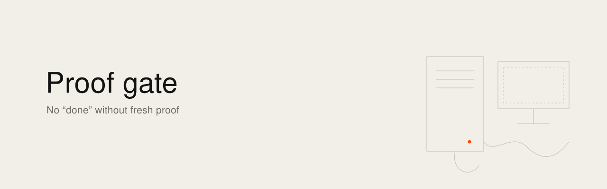

<picture><source media="(prefers-color-scheme: dark)" srcset="banner.svg"></picture>

[English](README.md) · [Français](README.fr.md)

# Proof gate

In October 2026, a script on my always-on server sent my usage data to an online leaderboard every morning. For two weeks the server refused every submission, 187 times, because the account now required signed requests. The script wrote each refusal into a log I never open, retried, and exited cleanly. Each run ended without an error, and nothing reached the leaderboard. I found out by looking at the leaderboard.

I work alone with a fleet of AI agents (Claude Code, Codex, Gemini CLI), scheduled tasks and scripts spread over a laptop, a small server and three GPU towers. Since August 2026 I keep a register of every incident where something did not happen and nothing said so: more than a hundred entries in three months. This repository gathers the method that came out of it and a selection of those cases, anonymized.

## The rule

A task is done when a fresh signal, observed on the real effect, says so. An exit code 0, a "success" message, a loaded scheduled job or a file on disk only prove that something started. The proof is read on the effect: the message in the sent folder, the row on the server, the size and checksum of the backup, the image on screen, read after the action.

## Three patterns

| | Pattern | Typical form |
|---|---|---|
| A | I checked that it started and stopped there | A tool answers "sent", "clicked", "success"; nothing happened |
| B | The implicit context is never tested absent | A symlink to an unmounted disk, the PATH of cron, a macOS permission tied to an old binary, the account that happens to be logged in |
| C | "Nothing to do" and "I failed" make the same silence | A watcher that ran 76 times without producing anything, a loop waiting for itself, an empty log that reads as calm |

One question for any automation: **if it does nothing, what do I see?** If the answer is "nothing", it is a silent failure waiting to happen, and the fix is to create the signal.

## Gate rules

These are the checks the gate applies before anything is called done.

1. **Proof before review.** Every "done" carries an observed signal, taken after the action: an output, a server row, a size and a checksum, a screenshot.
2. **Risk sets the friction.** A change is classified by what it touches. Low risk passes on proof alone. Standard risk asks me. Critical risk asks me a question about what changes before I can approve, because a lone developer approving their own work types "yes" by reflex.
3. **The reviewer comes from another family.** What a cloud model wrote is checked by different models, or by a deterministic tool.
4. **Loops are bounded.** Two agents that undo each other's work are stopped and the problem comes back to me.
5. **The rules guard themselves.** Any change to agent instructions, prompts or the gate's own configuration goes to the highest risk level.
6. **Every incident becomes a check, and every check speaks.** A check that finds nothing writes a dated line saying so; an alert that stays in a log file counts as no alert.

## Cases

[`cases/`](cases/README.md) holds the anonymized incidents, one file per case in English and French: what was expected, what happened, why nothing flagged it, how I found out, the signal I added, and the gate rule it gave.

## Status

The method and the cases are usable now, by reading them. A command-line gate (git hooks and post-action checks, running with local models) is being specified.

---

State verified on 24 October 2026.

Ismaël Joffroy Chandoutis, 2026. Texts under a [CC BY-SA 4.0](LICENSE) license.

By [Ismaël Joffroy Chandoutis](https://ismaeljoffroychandoutis.com).
